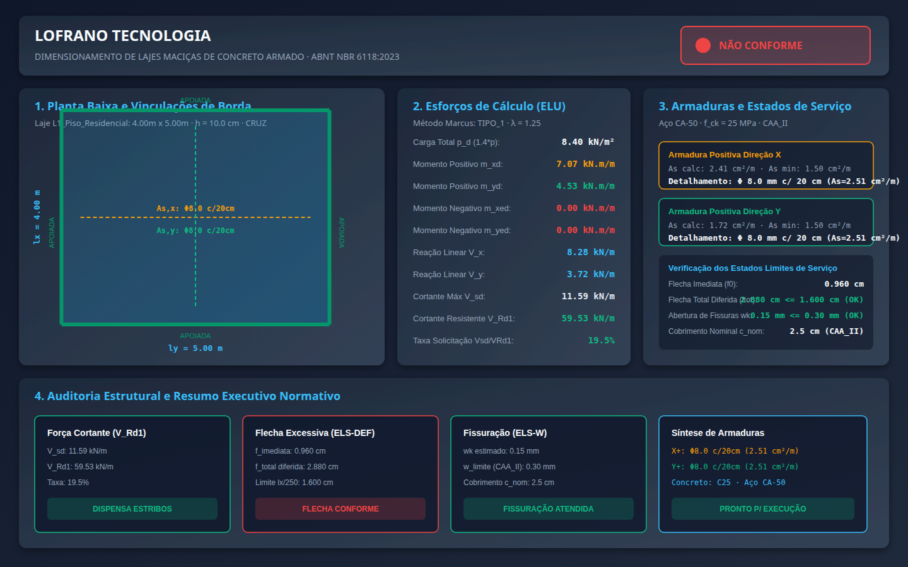

# Dimensionamento de Lajes Maciças de Concreto Armado (ABNT NBR 6118:2023)

[](https://github.com/martinlofranodeoliveira/dimensionamento-lajes-concreto-nbr6118/actions/workflows/ci.yml)
[](https://github.com/martinlofranodeoliveira/dimensionamento-lajes-concreto-nbr6118/releases/tag/v1.0.0)
[](https://www.python.org/)
[](LICENSE)
[](pyproject.toml)
[](src/lajes_concreto_nbr6118/calculator.py)

Biblioteca analítica e ferramenta de linha de comando (`CLI`) de alta precisão para dimensionamento estrutural, verificação no Estado Limite Último (ELU), detalhamento executivo de armaduras e verificação nos Estados Limites de Serviço (ELS-DEF e ELS-W) de **lajes maciças retangulares de concreto armado**, em estrita conformidade com as normas brasileiras **ABNT NBR 6118:2023** (*Projeto de estruturas de concreto - Procedimento*) e **ABNT NBR 6120:2019** (*Ações para o cálculo de estruturas de edificações*).

Desenvolvido segundo as diretrizes de engenharia de software da **LOFRANO TECNOLOGIA**:
- **Zero ponto flutuante (`float`)**: 100% dos cálculos físicos, mecânicos, geométricos e normativos utilizam aritmética racional exata (`Fraction`) e grandezas inteiras.
- **Zero dependências externas**: Funciona exclusivamente com a biblioteca padrão do Python (`math`, `fractions`, `dataclasses`, `json`, `csv`, `sqlite3`, `argparse`).
- **Codec canônico JSON**: Rejeição estrita de Byte Order Mark (BOM), chaves duplicadas, valores de ponto flutuante e profundidade de aninhamento excessiva (> 32 níveis).
- **Sanitização de CSV**: Proteção nativa contra injeção de fórmulas (`=`, `+`, `-`, `@`, `\t`, `\r`).
- **ZIP determinístico**: Empacotamento com timestamps fixos (`2026-01-01 00:00:00`) e garantia de não-sobrescrita atômica.
- **Painel visual técnico SVG 1440x900**: Diagramação vetorial da planta de fôrma, vinculações de contorno, malhas de aço e painel de indicadores normativos.

---

## Painel Visual Técnico (1440x900)

O sistema gera automaticamente um painel visual completo com planta baixa da laje, identificação das vinculações de borda (apoiada vs engastada), momentos fletores no ELU, detalhamento das armaduras positivas e negativas e laudos dos estados de serviço:



---

## Fundamentação Teórica e Formulação Matemática

### 1. Classificação Estrutural pela Relação de Forma ($\lambda$)

Dada uma laje maciça retangular com menor vão livre $l_x$ e maior vão livre $l_y$ ($l_x \le l_y$):

$$\lambda = \frac{l_y}{l_x}$$

- **Lajes armadas em duas direções (em cruz / bidirecionais)**: $\lambda \le 2{,}0$. A laje flexiona simultaneamente nas duas direções ortogonais e é calculada pela Teoria das Placas com consideração de torção pelo **Método de Marcus**.
- **Lajes armadas em uma direção (unidirecionais)**: $\lambda > 2{,}0$. A transferência de carga ocorre preponderantemente na direção do menor vão ($l_x$), sendo a armadura da direção $l_y$ dimensionada como armadura secundária de distribuição.

### 2. Espessuras Mínimas Normativas (NBR 6118 item 13.2.4.1)

Para prevenir vibrações e garantir a segurança ao cisalhamento e deformação:
- Cobertura não em balanço: $h \ge 7\text{ cm}$
- Piso residencial ou comercial não em balanço: $h \ge 8\text{ cm}$
- Lajes em balanço de cobertura: $h \ge 7\text{ cm}$; balanço de piso: $h \ge 10\text{ cm}$
- Lajes que suportem tráfego de veículos de peso total $\le 30\text{ kN}$: $h \ge 10\text{ cm}$
- Lajes que suportem tráfego de veículos de peso total $> 30\text{ kN}$: $h \ge 12\text{ cm}$

### 3. Ações e Carregamentos de Cálculo

- Peso próprio do concreto armado ($\gamma_c = 25\text{ kN/m}^3$): $g_{pp} = 25 \cdot (h / 100)\text{ kN/m}^2$.
- Carga permanente total: $g_{\text{tot}} = g_{pp} + g_{\text{adic}}$.
- Carga total de serviço: $p_k = g_{\text{tot}} + q_{\text{acidental}}$.
- Carga majorada de cálculo no ELU: $p_d = \gamma_f \cdot p_k = 1{,}40 \cdot p_k$.

### 4. Momentos Fletores pelo Método de Marcus

Para lajes bidirecionais, os momentos fletores característicos por metro de largura são obtidos pelas tabelas clássicas de Marcus com interpolação linear em frações exatas:

$$m_{x,k} = \mu_x \cdot \frac{p_k \cdot l_x^2}{100}, \quad m_{y,k} = \mu_y \cdot \frac{p_k \cdot l_x^2}{100}$$

$$m'_{xe,k} = \mu_{xe} \cdot \frac{p_k \cdot l_x^2}{100}, \quad m'_{ye,k} = \mu_{ye} \cdot \frac{p_k \cdot l_x^2}{100}$$

Os momentos de cálculo no ELU são majorados por $\gamma_f = 1{,}40$: $m_{xd} = 1{,}40 \cdot m_{x,k}$, etc.

### 5. Dimensionamento das Armaduras de Flexão no ELU

Em uma faixa unitária de largura $b = 100\text{ cm}$:
- Altura útil na direção X: $d_x = h - c_{\text{nom}} - \phi_x / 2$.
- Altura útil na direção Y: $d_y = d_x - \phi_x / 2 - \phi_y / 2$.
- Altura útil para momentos negativos: $d_{\text{neg}} = h - c_{\text{nom}} - \phi_{\text{eng}} / 2$.
- Momento fletor adimensional:

$$\mu = \frac{m_d}{b \cdot d^2 \cdot \sigma_{cd}}, \quad \text{onde } \sigma_{cd} = 0{,}85 \cdot \frac{f_{ck}}{\gamma_c}$$

- Limite de ductilidade normativo: $\xi = x/d \le 0{,}45 \implies \mu \le 0{,}2952$. Caso $\mu > 0{,}2952$, a laje exige aumento de espessura $h$.
- Posição da linha neutra calculada com raiz quadrada racional exata sem floats:

$$\xi = \frac{1 - \sqrt{1 - 2\mu}}{0{,}8}, \quad x = \xi \cdot d, \quad z = d - 0{,}40 \cdot x$$

- Área de armadura calculada: $A_s = \frac{m_d}{z \cdot f_{yd}}$ (com $f_{yd} = 500 / 1{,}15\text{ MPa}$).
- Taxa mínima geométrica de armadura de flexão (Tabela 17.3 da NBR 6118):
  - Para concreto C20 a C30: $\rho_{\min} = 0{,}150\% \implies A_{s,\min} = 0{,}0015 \cdot b \cdot h$.
- Armadura secundária de distribuição para lajes unidirecionais:

$$A_{s,\text{sec}} \ge \max(0{,}20 \cdot A_{s,\text{princ}}, 0{,}50 \cdot A_{s,\min}, 0{,}90\text{ cm}^2/\text{m})$$

- Espaçamentos normativos (item 20.1): $s \le \min(20\text{ cm}, 2h)$ para principal, $\min(33\text{ cm}, 3h)$ para secundária, e $s \ge 7\text{ cm}$.

### 6. Verificação ao Cisalhamento sem Armadura Transversal ($V_{Rd1}$)

Conforme item 19.4.1 da ABNT NBR 6118:2023, lajes maciças dispensam armadura transversal quando:

$$V_{sd} \le V_{Rd1} = \left[ \tau_R \cdot k \cdot (1{,}2 + 40 \rho_1) \right] b_w \cdot d$$

onde:
- $\tau_R = 0{,}25 \cdot f_{ctd} = 0{,}25 \cdot \frac{0{,}7 \cdot 0{,}3 \cdot f_{ck}^{2/3}}{\gamma_c}$.
- $k = |1 + \sqrt{200 / d_{\text{mm}}}| \le 2{,}0$.
- $\rho_1 = \min\left(\frac{A_{s1}}{b_w \cdot d}, 0{,}02\right)$.

### 7. Estados Limites de Serviço (ELS-DEF e ELS-W)

- **Deformação excessiva (Flecha)**:
  - Rigidez da placa: $D = \frac{E_{cs} \cdot h^3}{12 (1 - \nu^2)}$.
  - Flecha elástica imediata: $f_0 = \alpha \cdot \frac{p_k \cdot l_x^4}{D}$, com coeficientes de placa de Timoshenko interpolados racionalmente e fator de alívio por engastes.
  - Fluência diferida no tempo: $\alpha_f = 1{,}32$ para $t_0 \ge 30$ dias ($\Delta \xi = 2{,}0 - 0{,}68 = 1{,}32$).
  - Flecha total: $f_{\text{total}} = f_0 \cdot (1 + \alpha_f) \le l_x / 250$.
- **Fissuração**: abertura característica estimada $w_k \le w_{\lim}$ ($0{,}3\text{ mm}$ a $0{,}4\text{ mm}$ conforme a classe de agressividade ambiental).

---

## Instalação

O projeto requer **Python 3.11 ou superior** e **zero dependências externas**:

```bash
git clone https://github.com/martinlofranodeoliveira/dimensionamento-lajes-concreto-nbr6118.git
cd dimensionamento-lajes-concreto-nbr6118
pip install .
```

---

## Uso via Linha de Comando (CLI)

O comando `lajes-concreto` disponibiliza interface completa em português:

### 1. Dimensionamento e Memorial Descritivo em Texto
```bash
lajes-concreto calcular examples/laje_piso_residencial_cruz.json --formato texto
```

Trecho da saída gerada:
```
==================================================================================
   LOFRANO TECNOLOGIA — MEMORIAL DESCRITIVO DE DIMENSIONAMENTO ESTRUTURAL
             LAJES MACIÇAS DE CONCRETO ARMADO (ABNT NBR 6118:2023)
==================================================================================
Laje Identificador:        L1_Piso_Residencial
Tipo de Uso:               PISO_NAO_BALANCO
Classe de Agressividade:   CAA_II (Cobrimento c_nom = 2.5 cm)
Classe do Concreto:        C25 (f_ck = 25 MPa)
Aço Estrutural:            CA-50 (f_yk = 500 MPa, f_yd = 434.78 MPa)
----------------------------------------------------------------------------------
1. GEOMETRIA DA LAJE E CONDIÇÕES DE CONTORNO
  Menor Vão Livre (lx):    4.00 m
  Maior Vão Livre (ly):    5.00 m
  Relação de Forma (ly/lx): 1.25 -> Classificação: CRUZ
  Tipo de Contorno Marcus: TIPO_1
  Espessura Adotada (h):   10.0 cm
...
4. DETALHAMENTO DAS ARMADURAS DE FLEXÃO (Faixa Unitária de 100 cm)
  * Direção X_POSITIVA:
      Momento de Cálculo:  7.07 kN.m/m
      Altura Útil (d):     7.10 cm
      As Calculado:        2.41 cm²/m
      As Mínimo Normativo: 1.50 cm²/m
      As Adotado:          2.41 cm²/m
      Detalhamento:        Bitola 8.0 mm c/ 20 cm (5 barras/m)
      As Efetivo:          2.51 cm²/m
...
5. VERIFICAÇÃO DA FORÇA CORTANTE SEM ARMADURA TRANSVERSAL (V_Rd1)
  Cortante Solicitante Máx (V_sd): 11.59 kN/m
  Cortante Resistente (V_Rd1):     59.53 kN/m
  Taxa de Solicitação (Vsd/VRd1):  19.5%
  Diagnóstico de Cisalhamento:     APROVADO
...
7. CONCLUSÃO GERAL DE ENGENHARIA
  Parecer Estrutural: APROVADO E EM CONFORMIDADE
==================================================================================
```

### 2. Exportação em JSON Canônico
```bash
lajes-concreto calcular examples/laje_piso_residencial_cruz.json --formato json -o resultado.json
```

### 3. Exportação em Planilha CSV Sanitizada
```bash
lajes-concreto calcular examples/laje_piso_residencial_cruz.json --formato csv -o resultado.csv
```

### 4. Geração do Painel Técnico Vetorial SVG
```bash
lajes-concreto calcular examples/laje_piso_residencial_cruz.json --formato svg -o painel.svg
```

### 5. Geração de Pacote ZIP Determinístico
```bash
lajes-concreto calcular examples/laje_piso_residencial_cruz.json --formato zip -o pacote.zip
```

### 6. Verificação Rápida de Conformidade (Exit Code 0 ou 1)
```bash
lajes-concreto verificar examples/laje_piso_residencial_cruz.json
```

---

## Uso como Biblioteca Python

```python
from fractions import Fraction
from lajes_concreto_nbr6118 import (
    LajeEntrada,
    VinculacoesBordas,
    dimensionar_laje_completa,
    exportar_relatorio_texto,
)

# Definir laje com 4 bordas apoiadas (Marcus Tipo 1)
entrada = LajeEntrada(
    identificador="L1_Edificio",
    lx_m=Fraction(4, 1),             # 4.0 m
    ly_m=Fraction(5, 1),             # 5.0 m
    h_cm=Fraction(10, 1),            # 10 cm
    fck_classe="C25",
    classe_agressividade="CAA_II",
    tipo_uso="PISO_NAO_BALANCO",
    g_adicional_kn_m2=Fraction(3, 2),# 1.5 kN/m²
    q_acidental_kn_m2=Fraction(2, 1),# 2.0 kN/m²
    vinculacoes=VinculacoesBordas("APOIADA", "APOIADA", "APOIADA", "APOIADA"),
    bitola_x_mm="8.0",
    bitola_y_mm="8.0",
)

resultado = dimensionar_laje_completa(entrada)

print(f"Laje {resultado.entrada.identificador}: {resultado.esforcos.tipo_armacao}")
print(f"Armadura X: {resultado.armaduras['X_POSITIVA'].as_efetivo_cm2_m} cm²/m")
print(f"Cisalhamento atendido: {resultado.cisalhamento.atende}")
print(f"Conformidade NBR 6118: {resultado.conformidade_geral}")
```

---

## Testes Automatizados e Auditoria Independente

A suíte possui **55 testes unitários** automatizados e um **auditor independente SQLite em memória** que recalcula as equações constitutivas sem importar o código de produção:

```bash
# Execução dos 55 testes unitários
python -m unittest discover -s tests -v

# Execução do auditor independente em SQLite
python tools/verify_independent.py

# Construção de pacotes e validação de membros
python -m build
python scripts/check_distribution.py
```

---

## Licença

Distribuído sob a licença **MIT**. Consulte o arquivo [LICENSE](LICENSE) para obter detalhes.
Desenvolvido com excelência técnica por **Lofrano Tecnologia**.
